# Iris Studio — System Flow

Version 12 Nov 2026 · matches the prototype and `server/IrisStudio.Api` (incl. §4.2b 忘記密碼 and §4.5b 回報).

---

## 1. Architecture

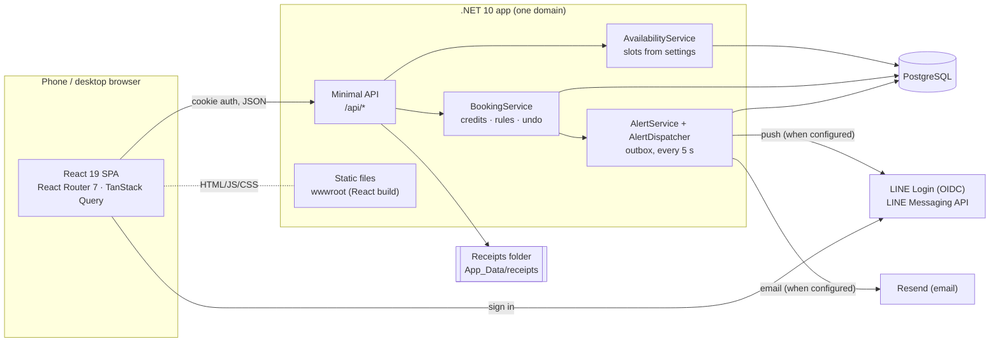

- **One origin**: the .NET app serves the React build and the API → no CORS, cookie is `SameSite`.
- **Mock / prototype mode**: the same React app runs against MSW handlers (`client/src/mocks`), which follow the same rules (`lib/availability.ts` is shared logic). The single-file demo HTML uses an in-memory version of these handlers.

---

## 2. Screens and routes

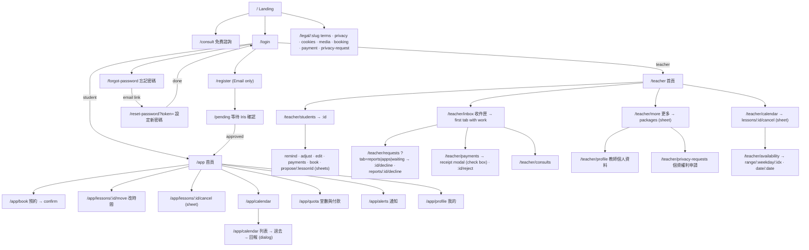

Sheets are **child routes**, so the phone back gesture closes them instead of leaving the page.

---

## 3. Data flow in the client

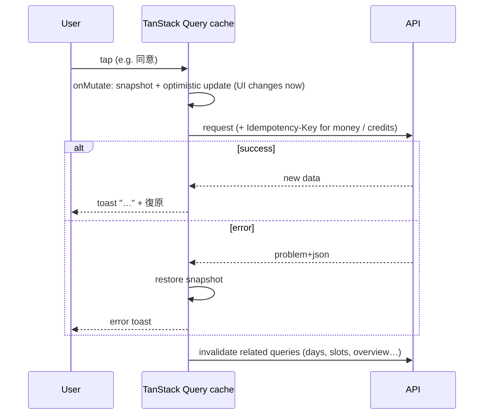

Caching: most queries `staleTime 30 s`; slots/days `staleTime 0` (always fresh before booking).

---

## 4. Key flows

### 4.1 Sign-up and approval
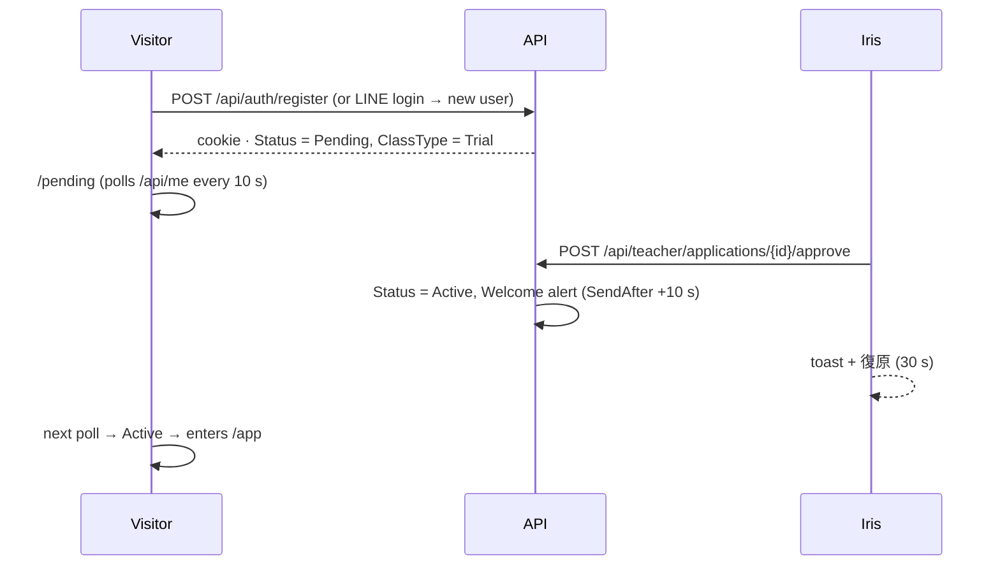

### 4.2 LINE Login
`GET /api/auth/line?returnUrl=…` → LINE OIDC (with `bot_prompt=aggressive`, so LINE asks the user to add the Iris Studio Official Account as a friend — only friends can receive LINE push) → `/api/auth/line/callback` → `OnTicketReceived` finds a user by `LineUserId` (`sub`) or creates a Pending one → issues the same cookie. `returnUrl` must be a same-site relative path (no open redirect). If LINE isn't configured → 503 `line_not_configured`.

### 4.2b 忘記密碼 (password reset)
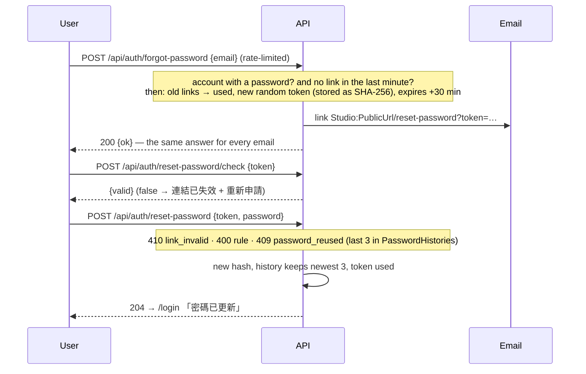
The demo can't send email, so its mock answer carries `demoLink` and the success page shows （示範）打開信中的連結 — the real server never returns the link.

### 4.3 Availability → slots
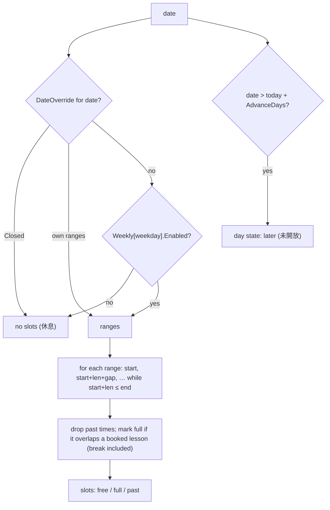
Iris's settings page shows the exact same result as a preview (`可預約 6 堂：09:30、11:00…`).

### 4.4 Booking
1. Student opens 預約 → `GET /api/slots/days?from=…` + `GET /api/slots?date=…`.
2. Picks a time → confirm sheet → `POST /api/student/lessons` with `Idempotency-Key`.
3. Server transaction: idempotency row → `EnsureValidSlotAsync` (in availability, future, within AdvanceDays) → per-date advisory lock → `IsTakenAsync` (overlap) → credits ≥ 1 → insert lesson (DurationMinutes = setting) → credits −1.
4. The lesson's `Type` is copied from the student's class type (一對一 / 團體課 / 體驗課).
5. If this booking used the **last credit**, an automatic 繳費提醒 is queued (see 4.8b).
6. 409 `slot_taken` if someone was faster: "沒有扣堂數，請選其他時段" and the slots refresh.
7. **Iris books for a student**: 學生詳細 → ＋ 預約課程 → same slot picker → `POST /api/teacher/lessons?studentId=` (idempotent). Same rules and transaction, uses one of the student's credits, student gets 老師新增了一堂課 (+10 s).

### 4.5 Cancel (student or Iris)
- Student: sheet tells *before* confirming whether the credit comes back (≥ 24 h). `POST …/lessons/{id}/cancel` → status Cancelled, refund if eligible → toast with 復原 (`undo-cancel`, 30 s, only if the slot is still free).
- Iris: 行事曆 → 取消 → sheet "堂數會退回 · 10 秒後通知學生" → always refunds; student alert queued 10 s.

### 4.5b 回報 a past lesson
Why: attendance is automatic (a Booked lesson becomes Attended when its time has passed), so a lesson the student did **not** attend still used a credit. 回報 lets the student ask Iris to cancel it afterwards; Iris decides, and an approved report costs a 取消費 instead of the whole lesson.

Rules: only `Attended` lessons, within `Studio:ReportDays` (7, 待 Iris 確認) days after the lesson ended, one report per lesson (unique index `UX_LessonReport_Lesson` on `LessonId` where Status ≠ Withdrawn — so a declined report is final, a withdrawn one can be sent again).
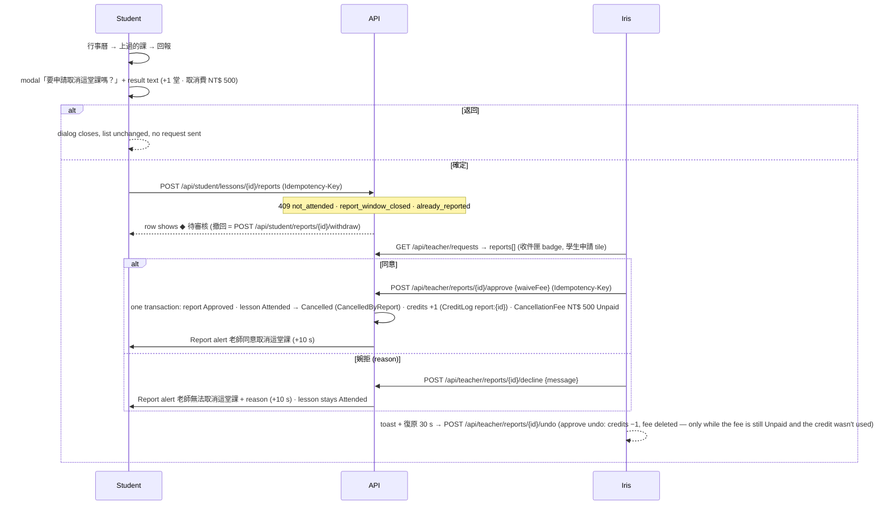
**取消費 on the next payment**: the student's 堂數與付款 page shows 未付取消費 NT$ 500 and the amount to transfer (package + fees). When the student uploads a receipt, every Unpaid fee is linked to it (`CancellationFee.PaymentId`, status Billed). Iris's receipt modal lists package + fees as the expected amount. Confirm → fees Paid. Reject → fees back to Unpaid (linked to the next upload). Undo-confirm → fees back to Billed. There is no payment gateway, so "charging" means the fee is added to the amount the student transfers and Iris checks it on the receipt.

### 4.6 Change time (改時間)
Rule: a student can ask only **≥ 12 h before** the lesson (`Studio:MoveHours`), otherwise 409 `too_late_to_move` and the app greys the option out with the reason. Iris can never move a lesson by herself (4.6b).
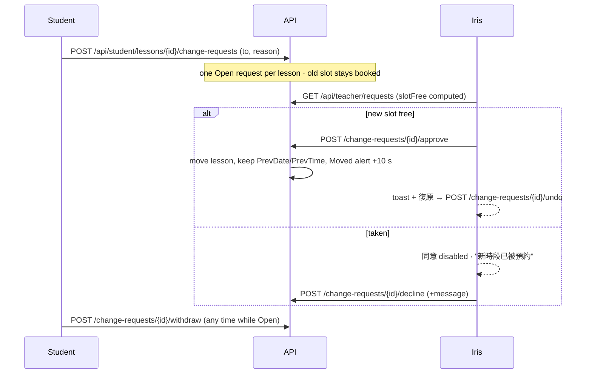

### 4.6b Iris proposes a new time (老師提議改時間)
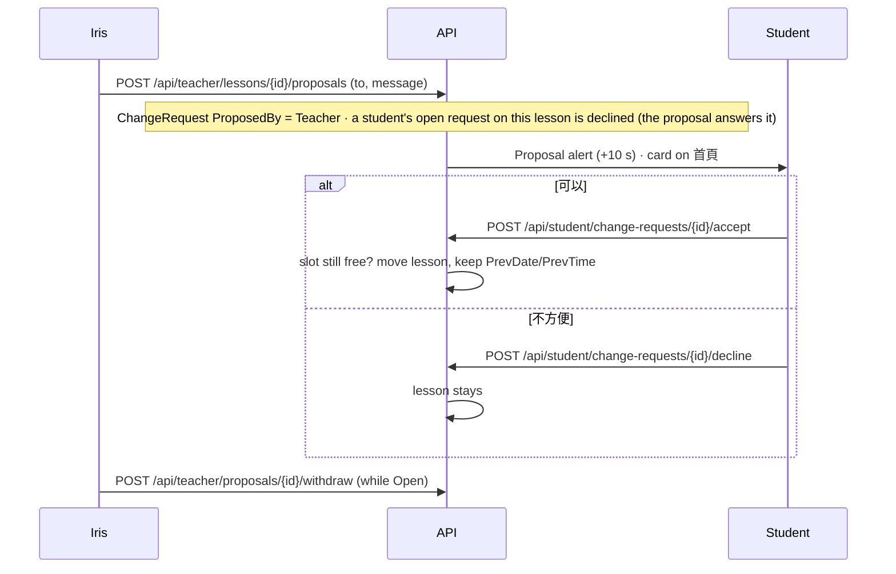
Entry points for Iris: 學生詳細 (提議改時間 per lesson), 行事曆 day list (改時間), and 申請 → 婉拒 → **婉拒並提議其他時間**. 申請 lists her proposals: ◆ 等待學生回覆 (收回), then 學生已接受 / 學生不方便 (再提議) for 7 days.

### 4.7 Payment (收據)
1. Any time, as long as no receipt is already waiting → student uploads receipt (`POST /api/student/payments`, multipart, ≤ 5 MB, image checked by content, LQIP made). Unpaid 取消費 are attached to this receipt and added to the expected amount (§4.5b).
   - Packages: 4 / 8 堂, and the one-time **體驗課 1 堂** only for students whose class type is 體驗 and who haven't bought it (a rejected receipt doesn't count). Credits never expire.
   - Trial journey: 15-min free chat → student registers → Iris approves → student buys 體驗課 → books. Done.
2. Iris → 付款 → receipt **modal** → 確認，加 N 堂 (`/confirm`, idempotent; credits + package; CreditLog `payment:{id}`) or 退回 (`/reject`, reason required).
3. Toast + 復原 (`/undo` removes the credits again, CreditLog `undo-payment:{id}`). Confirmed credits are **added on top** of what's left.
4. Student gets a Payment alert after 10 s.

### 4.8 通知學生繳學費 (manual reminder)
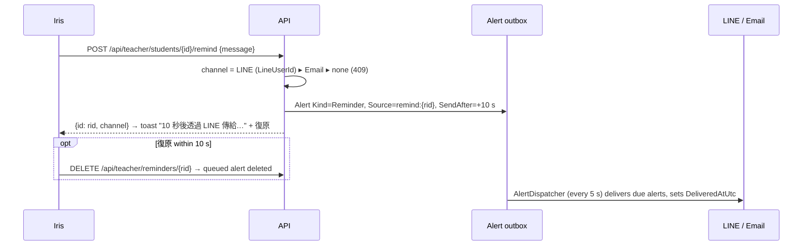
The 學生詳細 page shows `上次提醒：…`; the sheet warns when the last reminder was < 24 h ago.

### 4.8b Automatic 繳費提醒
When a booking (by the student or by Iris) leaves the student with **0 credits**, `AutoRemindAsync` queues a Reminder alert — unless a receipt is already pending or any reminder (manual or automatic) went out in the last 24 h. Source `auto-remind:{lessonId}`, so cancelling that lesson with a refund inside the 10 s delay drops it.

### 4.9 Availability editing
`GET /api/teacher/availability` → edit → `PUT …/weekly` (all 7 days) · `PUT …/settings` · `PUT|DELETE …/overrides/{date}`. Every save is optimistic with 復原 and invalidates `days`, `slots` and `studio` so students see the change immediately. Validation (both client and server): ranges sorted, no overlap, each ≥ one lesson; override date ≥ today; settings from the allowed lists. Existing lessons are **never** cancelled automatically — the special-date sheet lists them and points to 行事曆.

### 4.10 Free consult
`POST /api/public/consults` {name, contactType line|email, contact, preferredTime, topic} — rate-limited 5 / min / IP → appears in 諮詢 + counter on Iris's home → `POST /consults/{id}/contacted`.

### 4.11 Consents and privacy requests
1. Sign-up (email): `POST /api/auth/register` carries `consents`; user + consent rows are saved in one transaction.
2. Sign-up (LINE): choices wait in sessionStorage during the LINE redirect; `/pending` sends `POST /api/me/consents`.
3. 我的 → 同意設定: switching media / marketing writes a NEW row (version, time, scope, source). Withdrawing is always allowed; a minor turning one ON needs the guardian's tick.
4. Iris sees the latest media state on 學生詳細 before posting photos.
5. 個人資料權利申請 (`/legal/privacy-request`, no account needed) → `PrivacyRequests` → 更多 → 個資權利申請 with due date (15 d access/copy, 30 d others; 個資法 §13). Handling note required.
Cookie settings live in localStorage (`iris-cookie-prefs`); nothing optional runs today, `allowsAnalytics()` gates anything added later.

---

## 5. API reference

All responses JSON; errors are `application/problem+json` with a Chinese `detail` and a `code`.

| Method | Path | Who | Purpose |
|---|---|---|---|
| GET | `/api/public/studio` | anyone | lessonMinutes, cancelHours, moveHours, packages (trial flag), bank, teacher (name, avatar, status, message, LINE ID if public) |
| POST | `/api/public/consults` | anyone (rate-limited) | free-consult request |
| GET | `/api/me` | anyone | current user (+ classType, trialAvailable) or 401 |
| POST | `/api/auth/register` · `/login` · `/logout` | anyone | email accounts (login rate-limited); register requires `consents` (terms; guardian for minors) and the password rule |
| POST | `/api/auth/forgot-password` · `/reset-password/check` · `/reset-password` | anyone (rate-limited) | 忘記密碼: send link (always 200) / is the link valid / set the new password |
| GET | `/api/auth/line` | anyone | start LINE Login |
| GET | `/api/slots/days?from&count` | signed in | day states (open/closed/full/past/later) |
| GET | `/api/slots?date` | signed in | slot states for one date |
| GET/POST | `/api/student/lessons` | student | list / book (idempotent) |
| POST | `/api/student/lessons/{id}/cancel` · `/undo-cancel` | student | cancel / undo |
| POST | `/api/student/lessons/{id}/change-requests` | student | ask to move |
| POST | `/api/student/change-requests/{id}/withdraw` | student | withdraw own request |
| POST | `/api/student/change-requests/{id}/accept` · `/decline` | student | answer Iris's proposal |
| GET/POST | `/api/student/payments` | student | history / upload receipt (+ unpaid fees attached) |
| POST | `/api/student/lessons/{id}/reports` · `/api/student/reports/{id}/withdraw` | student | 回報 a past lesson / withdraw while Open  |
| GET | `/api/student/fees` | student | unpaid / billed 取消費  |
| GET | `/api/student/alerts` · POST `/alerts/read` | student | 通知 |
| PUT | `/api/student/profile` | student | profile |
| GET | `/api/receipts/{id}` | owner or teacher | receipt image |
| GET | `/api/teacher/overview` | teacher | home counters, today, out of quota |
| GET | `/api/teacher/lessons?from&to` · POST `/{id}/cancel` · `/{id}/undo-cancel` | teacher | calendar |
| POST | `/api/teacher/lessons?studentId=` | teacher | book for a student (idempotent) |
| POST | `/api/teacher/lessons/{id}/proposals` · `/api/teacher/proposals/{id}/withdraw` | teacher | propose a new time / take it back |
| GET | `/api/teacher/students` · `/students/{id}` | teacher | list / detail (+ remindChannel, lastRemindedAt) |
| POST | `/api/teacher/students/{id}/credits` | teacher | 調整堂數 {delta, reason} |
| PATCH | `/api/teacher/students/{id}/class-type` · `/grade` | teacher | 編輯 |
| POST | `/api/teacher/students/{id}/remind` · DELETE `/reminders/{rid}` | teacher | 通知學生繳學費 / undo |
| GET | `/api/teacher/requests` | teacher | 改時間 (student requests) + 新學生 + proposals |
| POST | `/api/teacher/change-requests/{id}/approve` · `/decline` · `/undo` | teacher | decide |
| POST | `/api/teacher/reports/{id}/approve` · `/decline` · `/undo` | teacher | decide a 回報 (+1 堂 and 取消費 on approve)  |
| POST | `/api/teacher/applications/{id}/{approve\|decline\|undo}` | teacher | new students |
| GET | `/api/teacher/payments?status` | teacher | 收據 |
| POST | `/api/teacher/payments/{id}/confirm` · `/reject` · `/undo` | teacher | decide (idempotent) |
| GET | `/api/teacher/availability` | teacher | settings + weekly + overrides |
| PUT | `/api/teacher/availability/settings` · `/weekly` · `/overrides/{date}` | teacher | edit |
| DELETE | `/api/teacher/availability/overrides/{date}` | teacher | remove special date |
| GET | `/api/teacher/consults` · POST `/consults/{id}/contacted` | teacher | 諮詢 |
| GET/PUT | `/api/teacher/profile` | teacher | 教師個人資料 (name, LINE ID + public flag, status, message) |
| POST/DELETE | `/api/teacher/profile/avatar` | teacher | avatar (JPG/PNG/WEBP by content, ≤ 2 MB) → `/api/public/avatars/{file}` |
| PUT | `/api/teacher/account/email` | teacher | change login email (current password required, EmailVerified → false) |
| DELETE | `/api/teacher/account/line` | teacher | unlink LINE Login (only if email + password exist) |
| GET/POST | `/api/me/consents` | signed in | own consent log / record a change (append-only) |
| POST | `/api/public/privacy-requests` | anyone (rate-limited) | 個人資料權利申請 |
| GET · POST | `/api/teacher/privacy-requests` · `/{id}/done` | teacher | list with due dates / mark handled (note required) |

---

## 6. Background work
| Job | When | Does |
|---|---|---|
| `AlertDispatcher` | every 5 s | releases alerts with `SendAfterUtc ≤ now` → `IAlertChannel` (in-app only today; LINE / email adapters plug in) → sets `DeliveredAtUtc` |
| `RetentionService` | every 6 h | deletes expired data: reset links 1 day after expiry, idempotency 24 h, consults 12 mo, read alerts 12 mo, handled privacy requests 3 y (`Studio:Retention`, proposed values) |
| `AttendanceSettler` | every minute (inside `AlertDispatcher`) | Booked lessons whose end time has passed → **Attended**; open change requests on them → Declined |

---

## 7. State diagrams

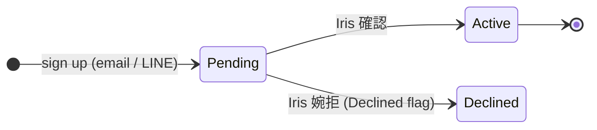

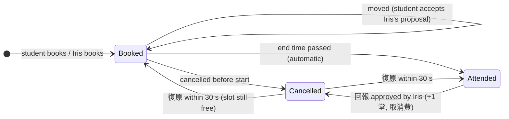

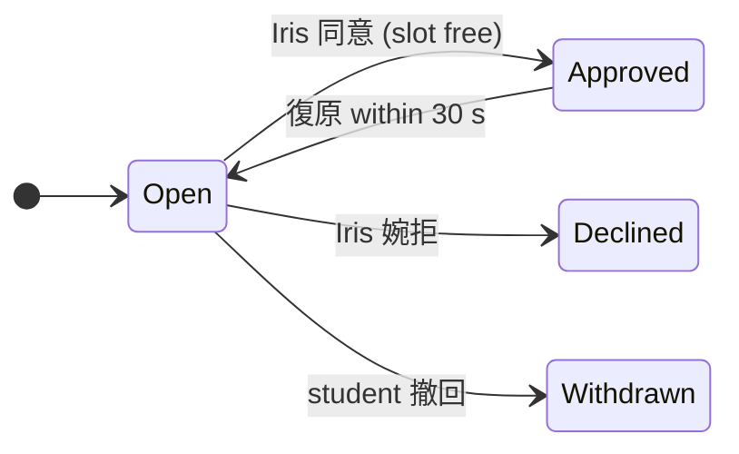
Same table, `ProposedBy = Teacher` (Iris's proposal): Open → Approved (student 可以) · Open → Declined (student 不方便) · Open → Withdrawn (Iris 收回). Any Open request on a lesson that has ended → Declined.

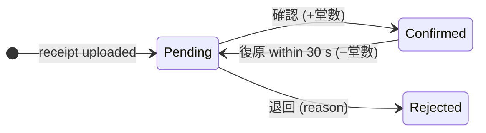

回報:
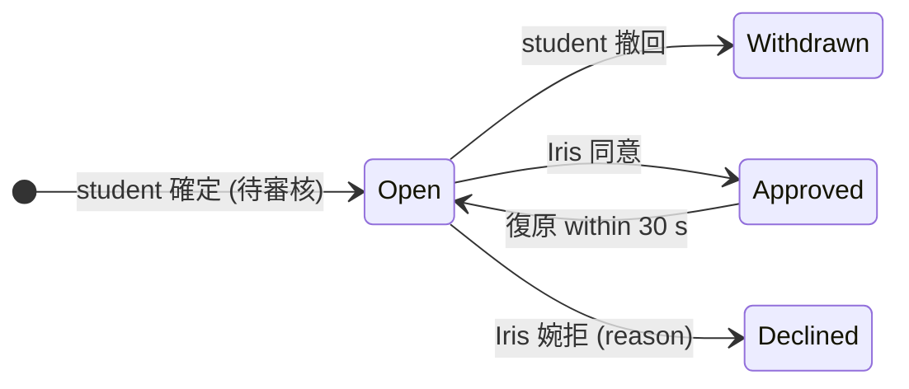

取消費:
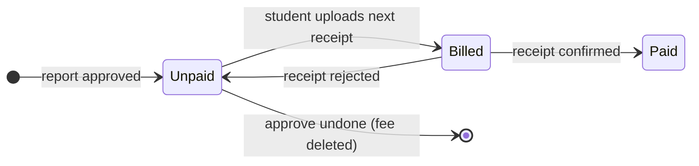

---

## 8. Alerts — who is told what

| Event | Student alert (Kind) | Delay |
|---|---|---|
| Application approved | 歡迎 (Welcome) | 10 s |
| Change request approved / declined | Approved / Declined | 10 s |
| Iris moves or cancels a lesson | Moved / Cancelled | 10 s |
| Receipt confirmed / rejected | Payment | 10 s |
| Iris adjusts 堂數 | Added | 10 s |
| 通知學生繳學費 | Reminder (Iris's own text) | 10 s |
| Booking used the last credit | Reminder (automatic, max 1 per 24 h, not if a receipt is pending) | 10 s |
| Iris proposes a new time | Proposal (old → new + her message) | 10 s |
| Iris books for the student | Added | 10 s |
| 回報 approved / declined | Report — 老師同意取消這堂課 (+1 堂, 取消費 NT$ 500 on the next payment, or 不收取消費) / 老師無法取消這堂課 (Iris's reason) | 10 s |

Iris's side has no alert list; her **counters** (待確認收據, 學生申請 = 改時間 + 回報, 新學生, 諮詢) and the 申請 / 付款 badges are computed live from the data.
