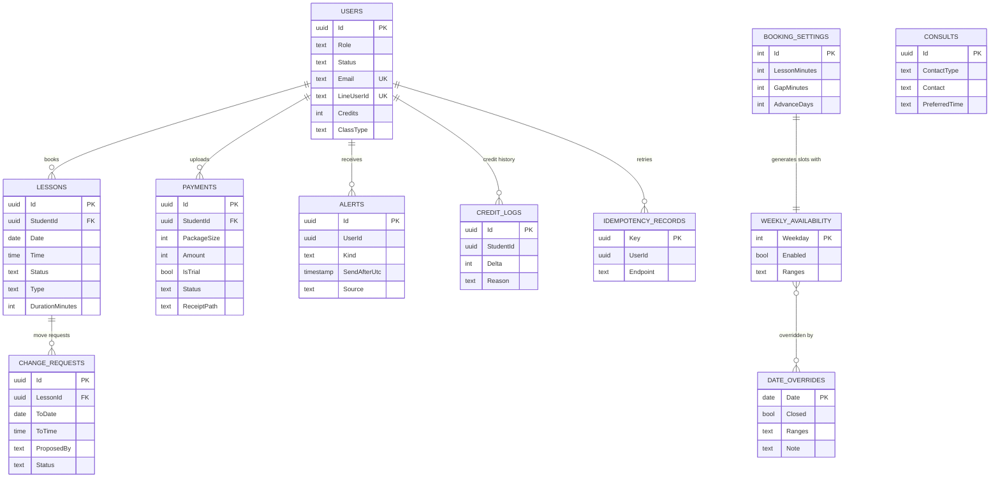

# Iris Studio — Database Schema

PostgreSQL · EF Core 10 (code-first) · source of truth: `server/IrisStudio.Api/Data/Entities.cs` + `AppDbContext.cs`.
Version 12 Nov 2026 v2.4 (adds `LessonReports`, `CancellationFees`, `PasswordResetTokens`, `PasswordHistories`, `Lessons.CancelledByReport`, AlertKind `Report` — used by the demo, migrations still to be committed). Earlier: 8 Nov 2026 v2.1 (adds availability tables, consult contact type / time window, payment reminders; then `ChangeRequests.ProposedBy`, `Payments.IsTrial`, AlertKind `Proposal`).

**Conventions**
- Primary keys are `uuid` (generated in .NET) except the three availability tables (natural keys).
- Every enum is stored as **text** (`"Booked"`, not `0`), max 16 chars — readable in SQL, safe to extend.
- Times: `date` + `time` columns are **studio local time** (Asia/Taipei). `…Utc` columns are `timestamp` in UTC.
- No soft delete: lessons are cancelled (status), never deleted; history stays.
- Committed migrations: `Initial` and `PaymentUndoMetadata`; applied at startup. Do not generate a second Initial migration.

---

## 1. ER diagram



---

## 2. Enums

| Enum | Values | Meaning |
|---|---|---|
| `Role` | Student, Teacher | one Teacher (Iris) |
| `UserStatus` | Pending, Active | Pending = waiting for Iris |
| `LessonStatus` | Booked, Attended, Cancelled | |
| `LessonType` | Private, Group, Trial | 一對一 / 團體課 / 單堂課 — one label set for lessons **and** the student's class type; the class type is copied to the lesson at booking |
| `ChangeStatus` | Open, Approved, Declined, Withdrawn | |
| `ChangeBy` | Student, Teacher | who asked: Student = 學生申請 (Iris decides), Teacher = 老師提議 (the student decides) |
| `PaymentStatus` | Pending, Confirmed, Rejected | |
| `AlertKind` | Moved, Approved, Declined, Payment, Added, Welcome, Cancelled, Reminder, Proposal, Report | Reminder = 通知學生繳學費 (manual or automatic) · Proposal = 老師想調整上課時間 |

---

## 3. Tables

### `Users`
| Column | Type | Null | Notes |
|---|---|---|---|
| Id | uuid | | PK |
| Name | varchar(80) | | |
| Role | text(16) | | Student / Teacher |
| Status | text(16) | | Pending → Active on approval |
| Email | varchar(200) | ✓ | **unique** where not null; lower-cased |
| PasswordHash | text | ✓ | PBKDF2; null for LINE-only accounts |
| Phone | text | ✓ | |
| LineUserId | text | ✓ | **unique** where not null; LINE Login `sub`, also the LINE push target |
| LineId | text | ✓ | LINE ID the student types (for Iris to search / contact) |
| VoiceType, Goal, Grade, AvatarUrl | text | ✓ | profile; Grade set by Iris |
| Credits | int | | lesson credits not yet booked — **check `Credits >= 0`** |
| PackageSize | int | | size of the last package (for the quota boxes) |
| ClassType | text(16) | | Private / Group / Trial — new sign-ups = Trial; labels 一對一 / 團體課 / 單堂課 |
| ConsultationCompleted | bool | | Default false; Iris confirms completed consultation/interview; independent of class type |
| Declined | bool | | application declined |
| CreatedAtUtc | timestamp | | |
| DecidedAtUtc | timestamp | ✓ | approval/decline time (undo window) |

### `Lessons`
| Column | Type | Null | Notes |
|---|---|---|---|
| Id | uuid | | PK |
| StudentId | uuid | | FK → Users (restrict delete) |
| Date | date | | studio local |
| Time | time | | studio local start |
| Status | text(16) | | Booked / Attended / Cancelled — Booked → Attended automatically once Date + Time + DurationMinutes has passed (`AttendanceSettler`) |
| Type | text(16) | | Private / Group / Trial |
| DurationMinutes | int | | copied from `BookingSettings.LessonMinutes` at booking time |
| CancelledAtUtc | timestamp | ✓ | |
| Refunded | bool | | credit returned on cancel |
| CancelledByTeacher | bool | | |
| CancelledByReport | bool | | cancelled afterwards by an approved 回報 |
| CreatedAtUtc | timestamp | | |

Indexes: **`UX_Lesson_Slot_Booked` unique (Date, Time) where Status = 'Booked'** (same-start double booking) · (StudentId, Date).
Overlapping starts (after Iris changes length/break) are blocked in code by `IsTakenAsync` under a per-date `pg_advisory_xact_lock`.

### `ChangeRequests` (改時間)
| Column | Type | Null | Notes |
|---|---|---|---|
| Id | uuid | | PK |
| LessonId | uuid | | FK → Lessons (cascade) |
| ToDate / ToTime | date / time | | requested slot |
| Reason | varchar(300) | | student's reason, or Iris's message when she proposes; shown in 「」 |
| ProposedBy | text(16) | | Student (default) / Teacher. A Teacher proposal only moves the lesson when the student accepts. |
| Status | text(16) | | Open / Approved / Declined / Withdrawn |
| PrevDate / PrevTime | date / time | ✓ | old slot, kept so an approval can be undone |
| CreatedAtUtc / DecidedAtUtc | timestamp | / ✓ | |

Index: **unique (LessonId) where Status = 'Open'** — one open request per lesson, from either side (Iris's proposal declines a student's open request first).
Rule in code: a student request needs ≥ `Studio:MoveHours` (12) before the lesson.

### `Payments` (收據)
| Column | Type | Null | Notes |
|---|---|---|---|
| Id | uuid | | PK |
| StudentId | uuid | | FK → Users (restrict) |
| PackageSize | int | | 1 (單堂課) / 4 / 8 |
| IsTrial | bool | | the one-time 單堂課 package; NT$1,500; allowed once after Iris confirms a consultation/interview (Rejected doesn't count) |
| Amount | int | | NT$ |
| PreviousPackageSize | int | ✓ | last package size before confirmation, restored by undo |
| Status | text(16) | | Pending / Confirmed / Rejected |
| ReceiptPath | text | | file under `Studio:ReceiptsFolder` (served only via `/api/receipts/{id}` to owner + teacher) |
| ContentType | text | | image/jpeg · png · webp (checked by file signature) |
| Lqip | text | ✓ | ~300-byte blurred data-URL preview |
| Note | text | ✓ | student note (e.g. 末五碼) |
| RejectReason | text | ✓ | required when rejected |
| UploadedAtUtc / DecidedAtUtc | timestamp | / ✓ | |

Indexes: (Status, UploadedAtUtc), unique StudentId where Pending, and unique (StudentId, IsTrial) where IsTrial and not Rejected. Buying is otherwise allowed any time and credits never expire.

### `LessonReports` (回報)
| Column | Type | Null | Notes |
|---|---|---|---|
| Id | uuid | | PK |
| LessonId | uuid | | FK → Lessons (restrict); `UX_LessonReport_Lesson` unique where Status ≠ Withdrawn — one report per lesson (declined is final) |
| StudentId | uuid | | FK → Users (restrict) |
| Reason | text | ✓ | optional, ≤ 300 |
| Status | text(16) | | Open / Approved / Declined / Withdrawn |
| DeclineReason | text | ✓ | required when Declined |
| FeeWaived | bool | | Iris ticked 這次免收取消費 |
| CreatedAtUtc / DecidedAtUtc | timestamp | / ✓ | allowed only ≤ `Studio:ReportDays` (7) after the lesson |

### `CancellationFees` (取消費)
| Column | Type | Null | Notes |
|---|---|---|---|
| Id | uuid | | PK |
| ReportId | uuid | | FK → LessonReports, unique |
| LessonId / StudentId | uuid | | FK (restrict) |
| Amount | int | | NT$, `Studio:CancelFee` (500) at approval time |
| Status | text(16) | | Unpaid / Billed / Paid |
| PaymentId | uuid | ✓ | FK → Payments; set when Billed |

Flow: approve → Unpaid · receipt upload → every Unpaid fee becomes Billed on it and `Payments.Amount` = package price + fees · receipt confirmed → Paid · rejected → Unpaid again. Approving sets the lesson to Cancelled and writes `CreditLogs` `report:{id}` (+1).

### `PasswordResetTokens` (忘記密碼)
| Column | Type | Null | Notes |
|---|---|---|---|
| Id | uuid | | PK |
| UserId | uuid | | FK → Users (cascade) |
| TokenHash | char(64) | | SHA-256 of the 256-bit token, **unique**; the raw token is only in the email |
| ExpiresAtUtc | timestamp | | created + `Studio:ResetLinkMinutes` (30) |
| UsedAtUtc / RevokedAtUtc | timestamp | ✓ | single use; a newer request revokes older ones |
| CreatedAtUtc | timestamp | | 1 / min / account |

### `PasswordHistories`
| Column | Type | Notes |
|---|---|---|
| Id | uuid | PK |
| UserId | uuid | FK → Users (cascade); index (UserId, CreatedAtUtc) |
| PasswordHash | text | PBKDF2; the new password may not match the **last 3** |
| CreatedAtUtc | timestamp | |

### `Alerts` (通知 + outbox)
| Column | Type | Null | Notes |
|---|---|---|---|
| Id | uuid | | PK |
| UserId | uuid | | recipient |
| Kind | text(16) | | AlertKind |
| Title / Body | text | | Body of a Reminder = Iris's edited message |
| Read | bool | | |
| CreatedAtUtc | timestamp | | |
| SendAfterUtc | timestamp | | now + 10 s for decisions → undo can delete it first |
| DeliveredAtUtc | timestamp | ✓ | set after successful delivery (or in-app processing when external delivery is disabled) |
| DeliveryAttempts | int | | failed attempts |
| NextAttemptUtc | timestamp | ✓ | retry backoff; independent of in-app visibility |
| Source | text | ✓ | `change:{id}`, `cancel:{id}`, `remind:{id}` … used by undo |

Indexes: (UserId, CreatedAtUtc) · (DeliveredAtUtc, SendAfterUtc) · (Source).

### `Consults` (免費諮詢)
| Column | Type | Null | Notes |
|---|---|---|---|
| Id | uuid | | PK |
| Name | varchar(80) | | |
| ContactType | varchar(10) | | `line` / `email` |
| Contact | varchar(120) | | LINE ID or email (email validated) |
| PreferredTime | varchar(20) | | `weekdayDay` / `weekdayEvening` / `weekend` / `any` |
| Topic | varchar(1000) | | optional |
| Contacted | bool | | |
| CreatedAtUtc | timestamp | | |

### `CreditLogs` (audit)
| Column | Type | Notes |
|---|---|---|
| Id | uuid | PK |
| StudentId | uuid | indexed |
| Delta | int | +/− |
| Reason | text | `payment:{id}`, `undo-payment:{id}`, `booking:{id}`, `cancel:{id}`, `undo-cancel:{id}`, `manual: 補課：…`, `undo-credits:{id}` |
| ByUserId | uuid? | FK to Users; who did it |
| UndoneAtUtc | timestamp? | marks a manual adjustment already undone |
| CreatedAtUtc | timestamp | |

### `IdempotencyRecords`
| Column | Type | Notes |
|---|---|---|
| Key | uuid | PK — the client's `Idempotency-Key` |
| UserId | uuid | |
| Endpoint | text | |
| RequestHash | text | same key + different body → 422 |
| StatusCode / ResponseJson | int? / jsonb? | replayed on retry (JSONB preserves values, not whitespace/order) |
| ResponseLocation | text? | original Location header for 201 replay |
| CreatedAtUtc | timestamp | indexed (for cleanup) |

Written in the **same transaction** as the action it protects.

### `BookingSettings` (預約設定) — single row, Id = 1
| Column | Type | Default | Allowed |
|---|---|---|---|
| Id | int | 1 | PK, not generated |
| LessonMinutes | int | 60 | 30, 45, 60, 90, 120 |
| GapMinutes | int | 30 | 0, 10, 15, 30, 60 |
| AdvanceDays | int | 30 | 7, 14, 30, 60, 90 |

### `WeeklyAvailability` (每週時段) — 7 rows
| Column | Type | Notes |
|---|---|---|
| Weekday | int | PK, 0 = Sunday … 6 = Saturday |
| Enabled | bool | OFF keeps its ranges, so switching back on restores them |
| Ranges | varchar(200) | `"09:30-12:30;14:00-20:30"` — sorted, no overlap, each ≥ lesson length |

### `DateOverrides` (特殊日期)
| Column | Type | Notes |
|---|---|---|
| Date | date | PK, today or later |
| Closed | bool | true = 全天休息 |
| Ranges | varchar(200) | own hours when not closed |
| Note | varchar(60) | e.g. 參加音樂會 |

Ranges are plain text on purpose (simple to read in SQL, no JSON mapping); `AvailabilityService.ParseRanges / FormatRanges` convert them.

---

## 4. Derived data (not stored)

| Value | How |
|---|---|
| Bookable slots for a date | override (closed / ranges) or weekly ranges → starts every `LessonMinutes + GapMinutes` while `start + LessonMinutes ≤ end` |
| Slot state | `past` if started · `full` if it overlaps a booked lesson (break included) · else `free` |
| Day state | `past` · `later` (beyond AdvanceDays) · `closed` (no ranges) · `full` · `open` |
| Booked count | Lessons with Status = Booked and in the future |
| Payment pending | any Payment with Status = Pending |
| Last reminded | max(Alerts.CreatedAtUtc) where Kind = Reminder |
| Remind channel | `line` if LineUserId, else `email` if Email, else none |
| Single lesson available (`trialAvailable`) | Active student with ConsultationCompleted and no Payment with IsTrial and Status ≠ Rejected; regular packages remain available |

## 5. Seed (first start)
Teacher account from `Studio:TeacherEmail / TeacherPassword` · BookingSettings defaults · WeeklyAvailability Mon–Sat `09:30-12:30;14:00-20:30`, Sunday off · demo students + lessons only when demo seeding is on.

## 6. Useful queries

```sql
-- Today's lessons (pass the studio date from the app; CURRENT_DATE uses the DB time zone)
SELECT u."Name", l."Time", l."Type" FROM "Lessons" l JOIN "Users" u ON u."Id" = l."StudentId"
WHERE l."Date" = @today AND l."Status" = 'Booked' ORDER BY l."Time";

-- Students who need a 繳費提醒: no credits, nothing booked, no receipt waiting
SELECT u."Name" FROM "Users" u
WHERE u."Role" = 'Student' AND u."Status" = 'Active' AND u."Credits" = 0
  AND NOT EXISTS (SELECT 1 FROM "Lessons" l WHERE l."StudentId" = u."Id" AND l."Status" = 'Booked' AND l."Date" >= @today)
  AND NOT EXISTS (SELECT 1 FROM "Payments" p WHERE p."StudentId" = u."Id" AND p."Status" = 'Pending');

-- Money confirmed this month
SELECT COALESCE(SUM("Amount"), 0) FROM "Payments"
WHERE "Status" = 'Confirmed' AND "DecidedAtUtc" >= date_trunc('month', now() AT TIME ZONE 'UTC');

-- Why does a student have N credits? (audit)
SELECT "CreatedAtUtc", "Delta", "Reason" FROM "CreditLogs" WHERE "StudentId" = @id ORDER BY "CreatedAtUtc";
```

## 7. Known gaps / next migrations

| Item | Note |
|---|---|
| User references | FKs now cover Alerts, CreditLogs (student and actor), and IdempotencyRecords |
| Receipts on local disk | back up `App_Data/receipts` with the DB, or move to object storage |
| `IdempotencyRecords` cleanup | implemented by StudioMaintenance, daily, delete > 24 h |
| Group classes with capacity | **pending decision** — would replace `UX_Lesson_Slot_Booked` with a per-slot capacity |
| Re-apply after decline | **pending decision** — today `Users.Declined` blocks it |
| New columns since the first draft | `ChangeRequests.ProposedBy`, `Payments.IsTrial` — included in the committed Initial migration |
| 回報 tables | `LessonReports`, `CancellationFees`, `Lessons.CancelledByReport` — `dotnet ef migrations add LessonReports` (both providers) |
| Password reset | `PasswordResetTokens`, `PasswordHistories` — `dotnet ef migrations add PasswordReset` (both providers) |
| Phase 2 | `Homework`, `HomeworkSubmissions`, `Events`, `EventInvites` |

## 8. Added 8 Nov (later): teacher profile, consents, privacy requests

| Table / column | Notes |
|---|---|
| `Users.EmailVerified`, `LineIdPublic`, `TeacherStatus` (Normal/Vacation/NoNewStudents/Custom), `StatusLabel` (12), `StatusMessage` (60) | teacher profile; `LineId` max 30 |
| `ConsentRecords` (Id, UserId FK restrict, Kind Terms/Privacy/Media/Marketing/Guardian, Granted, Version 40, Scope 100, Source Register/Profile/Request, GuardianName/Relation/Contact, CreatedAtUtc) | **append-only** consent log; index (UserId, Kind, CreatedAtUtc) |
| `PrivacyRequests` (Id, Name 80, Contact 120, Type Access/Copy/Correct/Stop/Delete/Withdraw, Detail 1000, Done, Note 500, CreatedAtUtc, HandledAtUtc) | 個資法 §13: due = created + 15 d (Access/Copy) or 30 d |
| Enum conversions added | `ChangeBy`, `TeacherStatus`, `ConsentKind`, `ConsentSource`, `PrivacyRequestType` stored as text |

Retention job (`RetentionService`, every 6 h, `Studio:Retention`): idempotency 24 h · consults 12 mo · read alerts 12 mo · handled privacy requests 3 y. See `LEGAL.md`.
